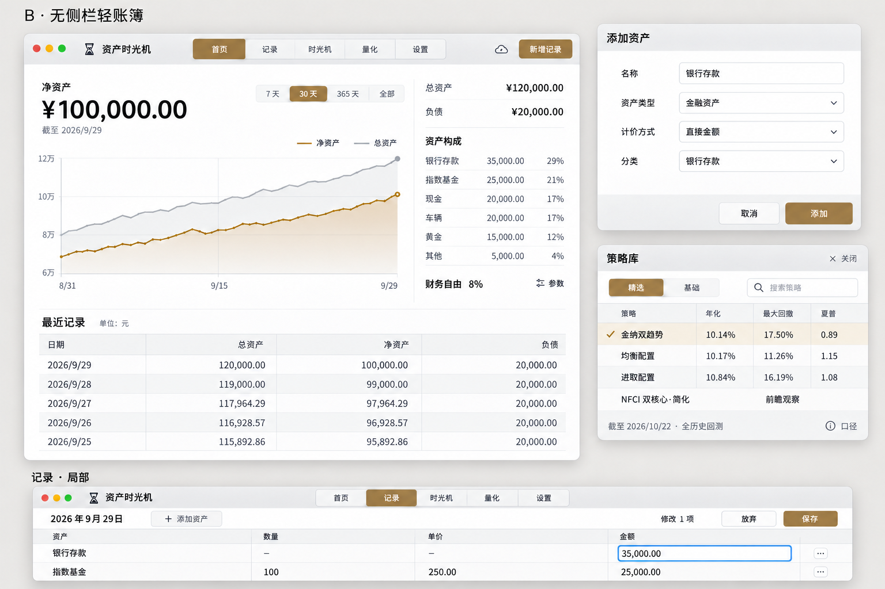
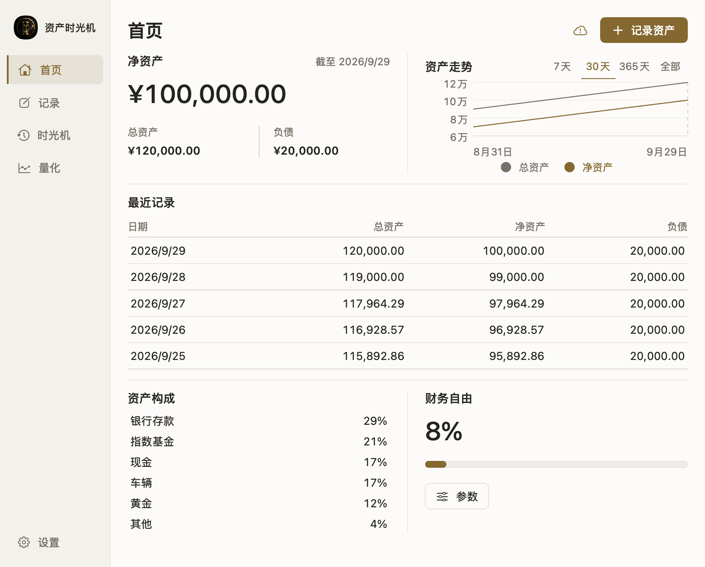
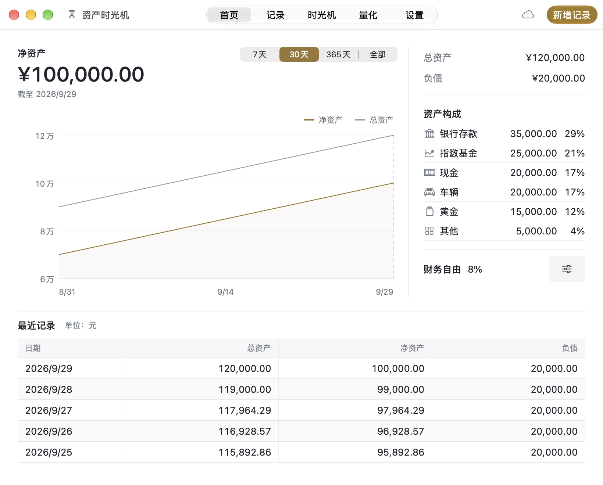
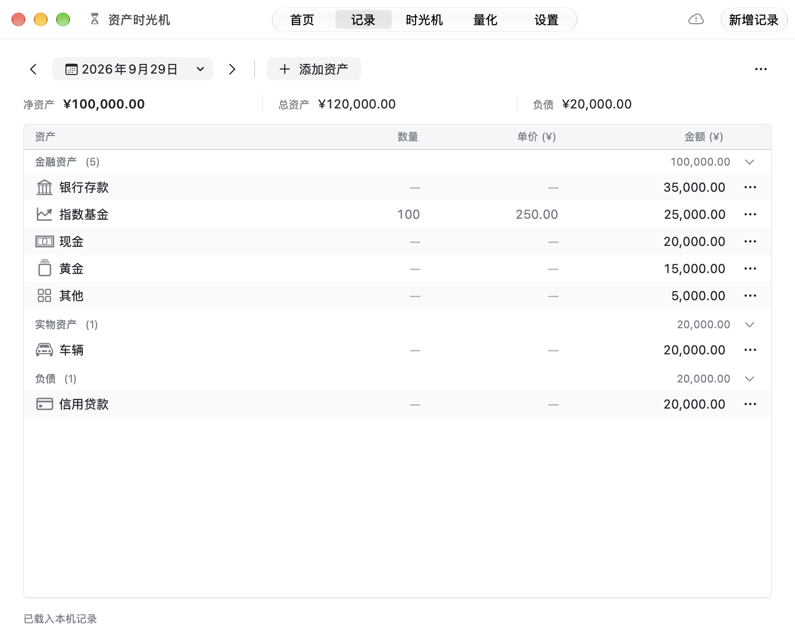
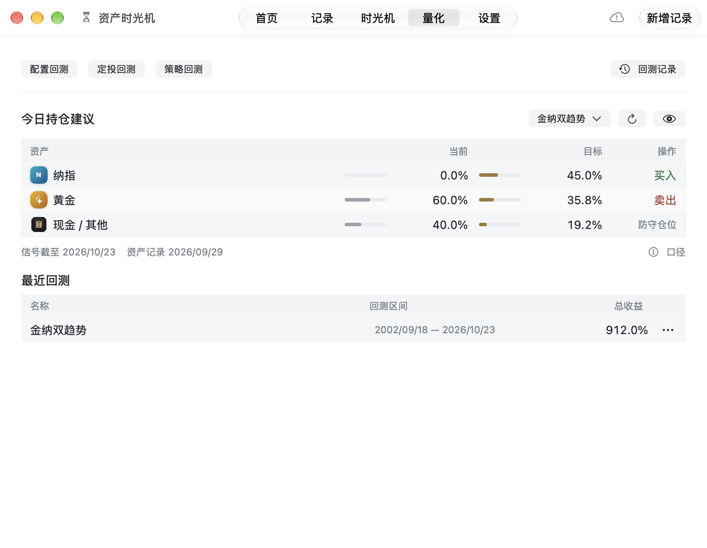
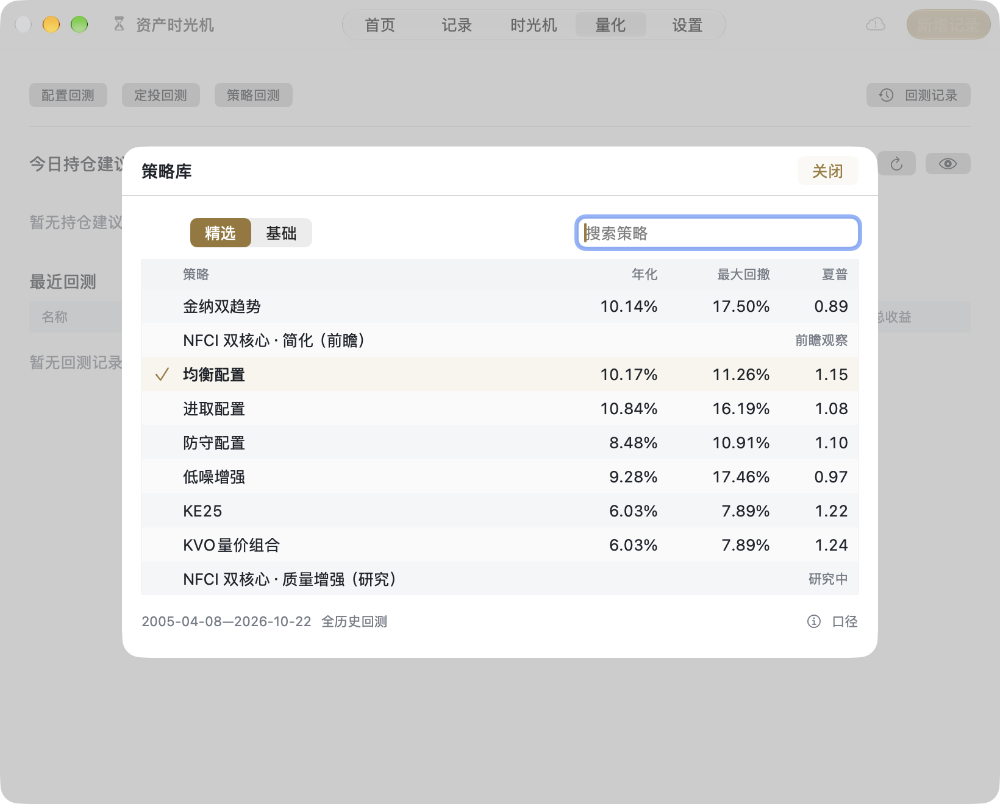

# Mac 原生 B 版界面与资产图标恢复

用户选择“无侧栏轻账簿”后，以真实 AppKit 统一顶栏替换侧栏；首页采用宽走势、资产轨道和全宽记录表。记录、时光机、量化和设置统一排版密度，短表单及策略列表共用弹窗结构。保留编辑保存、未保存拦截、键盘操作与同容器登录切换。恢复资产已有图标及行情 Logo，PNG/SVG 加载和缓存通过共享实现适配 AppKit。

模型、同步协议、策略计算和服务接口未改变；未发布、上架或替换 Applications 安装。默认完整窗口820×660，最小800×620，尊重恢复尺寸。

## 验证

- 原生 Mac Release 构建与签名验证通过；iPhone Release 编译兼容、本地化审计和差异检查通过。
- B 版此前实际119项操作通过（为动作数，非119个独立测试），覆盖编辑保存／取消、未保存拦截、策略搜索选择、Return／Escape／Cmd快捷键及云同步／登录单容器。后续展示微调和图标恢复没有重跑全套。
- 本次图标修复后，首页、记录与有数据量化界面已原生实拍；共享加载器通过PNG、SVG、重复缓存和404检查。所有截图均为隔离内存样例，量化使用仓库固定公开历史及现有引擎，无真实账户写入。
- 本地可运行产物由 `MAC_BUILD_ONLY=1 bash scripts/run_native_mac.sh` 生成到固定 `build/AssetTimeMachine-Native.app`。验证使用 `bash scripts/validate_xcode_build.sh ios`、`python3 scripts/audit_localizations.py`、`git diff --check`。

## 验收限制

完整视觉验收未标记通过：选定概念的严格像素门槛未满足（MAE0.06836、相似0.93164、容差内85.24%，为末轮微调前B实拍，不是当前构建分数）。10月26日最终整轮键盘复测受系统锁屏阻断。10月27日图标截图巡回在时光机激活时失败；首页、记录已成功实拍，随后量化巡回成功。时光机本次仅保留本地原生视图缓存，最小记录实拍未执行到。真实账户切换、云端恢复／删除及完整减少动态效果动态检查未执行，不以构建替代这些验收。

仓库本地化工具扫描共享iPhone代码和目录，不能据此宣称所有原生中文均已国际化。本轮可比五个原生文件新增中文目录缺失为0。

## 选定稿及实际截图

选定稿是展示板，不是运行截图。旧首页图为正文820×660，新首页及记录是完整窗口820×660；保留原始比例，不能直接当作同边界像素对照。策略库来自B版此前实际窗口截图；其余新版截图包含10月27日资产图标修复。所有图不含个人账户或金融记录。

验证摘要与图片哈希见[validation.json](validation.json)。详细生成过程、失败尝试及大量中间截图留在本地 `evidence/ui-concepts/`。
